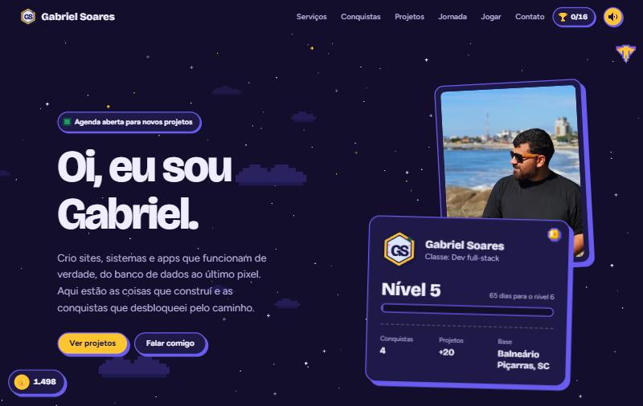

# gabrielsoares.me

Meu site pessoal e portfólio, com cara de jogo 8-bit. No ar em **[gabrielsoares.me](https://gabrielsoares.me)**.



## O que tem nele

- **Ficha de personagem**: nível e barra de XP calculados pelos anos de carreira.
- **Seções como mundos**: o Mundo 1 mostra o que eu faço (serviços, como funciona e projetos), o Mundo 2 quem eu sou (sobre, conquistas, jornada e inventário, em abas) e o Mundo 3 tira dúvidas (perguntas frequentes e blog). Faixas de nuvem de pixel separam um mundo do outro.
- **Conquistas secretas** para o visitante, salvas no navegador, com painel de troféus e botão para desafiar um amigo.
- **Moedas escondidas** pela página e um contador de likes compartilhado entre todos os visitantes.
- **Fase bônus "Bug em produção"**: um minijogo de nave desenhado em canvas.
- **Sons 8-bit** gerados na hora pela Web Audio API, sem arquivos de áudio.
- **Música de fundo em loop**, uma para o dia e outra para a noite. Começa desligada; o visitante liga no alto-falante do topo (ou com `musica` no terminal) e o site lembra a escolha. O arquivo só é baixado por quem liga.
- **Dia e noite**: nuvens de pixel no modo claro, estrelas no escuro.
- **Blog "Diário de bordo"**: posts escritos em texto simples (Markdown) e transformados em páginas pelo `gerar-blog.js`, com feed RSS e a conquista secreta "Leitor de bordo".
- **SEO local**: dados estruturados (schema.org), sitemap e robots.txt.
- **Medição de visitas com consentimento**: o Google Analytics só carrega depois do "Aceitar" no aviso de cookies, e mede quantos visitantes clicam para chamar no WhatsApp.

## Como é feito

HTML, CSS e JavaScript puros, sem framework e sem etapa de build. Um pouco de PHP só para o contador de likes.

| Arquivo | Para que serve |
|---|---|
| `dados.js` | Todo o conteúdo do site (textos, projetos, conquistas, links). Editar aqui atualiza a página inteira. |
| `script.js` | Monta as seções a partir de `dados.js` e cuida das animações, sons, conquistas e do minijogo. |
| `ceu.js` | Céu de fundo (nuvens e estrelas) e botão dia/noite, usados na página inicial e no blog. |
| `medicao.js` | Aviso de cookies, Google Analytics (só depois do "Aceitar") e o evento de clique no WhatsApp. O ID do Analytics fica no topo do arquivo. |
| `style.css` | Visual, temas claro/escuro e cursor de pixel. Vale para o site inteiro, blog incluído. |
| `posts/` | Os textos do blog, um arquivo `.md` por post. `_modelo.md` mostra como escrever. |
| `paginas/` | Páginas avulsas em `.md`, como a política de privacidade (`privacidade.md`). |
| `gerar-blog.js` | Transforma `posts/` nas páginas de `blog/` e `paginas/` em páginas como `privacidade/`, gera o `404.html`, refaz o `sitemap.xml` e, no `index.html`, a seção do blog e o conteúdo para quem não roda JavaScript. |
| `blog/`, `privacidade/`, `404.html` | Gerados pelo `gerar-blog.js`. Não edite à mão. |
| `.htaccess` | Página de erro 404, redirecionamento do www e proteções básicas do navegador. |
| `blog.js` | Barra de leitura, conquistas e "Copiar link" nas páginas do blog. |
| `api/likes.php` | Contador de likes. Grava o total em `api/likes.txt`, criado no primeiro acesso. |

## Escrevendo no blog

1. Copie `posts/_modelo.md` para um arquivo novo, como `posts/meu-post.md`. O nome vira o endereço: `gabrielsoares.me/blog/meu-post/`.
2. Preencha o cabeçalho (título, descrição, data e emoji) e escreva o texto embaixo.
3. Veja a prévia com os rascunhos e abra `http://localhost:3000/blog/`:

   ```bash
   node gerar-blog.js --rascunhos
   npx serve .
   ```

4. Para publicar, troque `rascunho: true` por `rascunho: false` e gere a versão final, sem a opção de prévia:

   ```bash
   node gerar-blog.js
   ```

5. Suba para o servidor a pasta `blog/`, o `index.html` e o `sitemap.xml`. A pasta `posts/` não precisa ir.

## Trocando a música de fundo

1. Coloque o MP3 na pasta `musica/`.
2. Em `dados.js`, aponte `musica.dia` (e, se quiser, `musica.noite`) para o arquivo.
3. Se a música termina em fade ou silêncio, preencha `loop` com o trecho que se repete, em segundos. O fim precisa cair no começo de um compasso, no mesmo ponto da música em que o trecho começa. Para achar o tamanho de um compasso, divida 240 pelo BPM: a 90 BPM, um compasso dura 2,67 s.

## Medindo as visitas (Google Analytics)

1. No [Google Analytics](https://analytics.google.com), crie uma propriedade com um fluxo de dados da Web para `gabrielsoares.me` e copie o ID (começa com `G-`).
2. Cole o ID em `ID_ANALYTICS`, no topo do `medicao.js`. Com o ID vazio, o aviso de cookies não aparece e nada é medido.
3. Ainda no Analytics, em **Administrador**:
   - **Definições personalizadas**: crie as dimensões `origem` e `servico`, as duas com escopo de evento. `origem` diz de onde veio o clique no WhatsApp (`servicos`, `monte_sua_missao`, `fase_bonus`, `fim_do_post`, `contato`, `terminal`, `console` ou `outro`). `servico` diz qual serviço, quando o clique foi no "Pedir orçamento".
   - **Eventos principais**: marque `clique_whatsapp`, que aparece na lista depois do primeiro clique.
   - **Retenção de dados**: troque para 14 meses, o prazo que a página de privacidade promete como máximo.
4. Troque o `?v=` no `index.html`, rode `node gerar-blog.js` e suba os arquivos alterados.

O texto da política fica em `paginas/privacidade.md`. Se o site passar a medir outra coisa, atualize a política junto.

## Rodando localmente

Qualquer servidor estático serve. Por exemplo:

```bash
npx serve .
```

O contador de likes precisa de PHP. Sem ele, o resto do site funciona normalmente. Para testar os likes:

```bash
php -S localhost:8000
```

## Licença

O código pode servir de referência e inspiração. Os textos, a foto e a marca Gabriel Soares são meus e não podem ser reutilizados.
