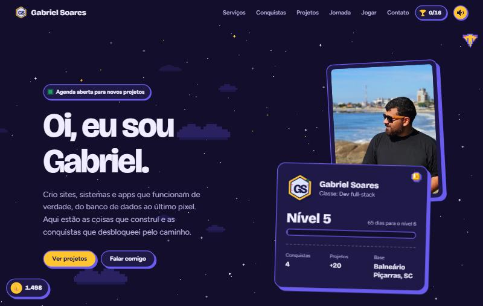

# gabrielsoares.me

Meu site pessoal e portfólio, com cara de jogo 8-bit. No ar em **[gabrielsoares.me](https://gabrielsoares.me)**.



## O que tem nele

- **Ficha de personagem**: nível e barra de XP calculados pelos anos de carreira.
- **Seções como mundos**: o Mundo 1 mostra o que eu faço (serviços, como funciona e projetos), o Mundo 2 quem eu sou (sobre, conquistas, jornada e inventário, em abas) e o Mundo 3 tira dúvidas (perguntas frequentes e blog). Faixas de nuvem de pixel separam um mundo do outro.
- **Conquistas secretas** para o visitante, salvas no navegador, com painel de troféus e botão para desafiar um amigo.
- **Moedas escondidas** pela página e um contador de likes compartilhado entre todos os visitantes.
- **Fase bônus "Bug em produção"**: um minijogo de nave desenhado em canvas.
- **Sons 8-bit** gerados na hora pela Web Audio API, sem arquivos de áudio.
- **Dia e noite**: nuvens de pixel no modo claro, estrelas no escuro.
- **Blog "Diário de bordo"**: posts escritos em texto simples (Markdown) e transformados em páginas pelo `gerar-blog.js`, com feed RSS e a conquista secreta "Leitor de bordo".
- **SEO local**: dados estruturados (schema.org), sitemap e robots.txt.

## Como é feito

HTML, CSS e JavaScript puros, sem framework e sem etapa de build. Um pouco de PHP só para o contador de likes.

| Arquivo | Para que serve |
|---|---|
| `dados.js` | Todo o conteúdo do site (textos, projetos, conquistas, links). Editar aqui atualiza a página inteira. |
| `script.js` | Monta as seções a partir de `dados.js` e cuida das animações, sons, conquistas e do minijogo. |
| `ceu.js` | Céu de fundo (nuvens e estrelas) e botão dia/noite, usados na página inicial e no blog. |
| `style.css` | Visual, temas claro/escuro e cursor de pixel. Vale para o site inteiro, blog incluído. |
| `posts/` | Os textos do blog, um arquivo `.md` por post. `_modelo.md` mostra como escrever. |
| `gerar-blog.js` | Transforma `posts/` nas páginas de `blog/`, refaz o `sitemap.xml` e a seção do blog no `index.html`. |
| `blog/` | Gerada pelo `gerar-blog.js`. Não edite à mão. |
| `blog.js` | Barra de leitura, conquistas e "Copiar link" nas páginas do blog. |
| `api/likes.php` | Contador de likes. Grava o total em `api/likes.txt`, criado no primeiro acesso. |

## Escrevendo no blog

1. Copie `posts/_modelo.md` para um arquivo novo, como `posts/meu-post.md`. O nome vira o endereço: `gabrielsoares.me/blog/meu-post/`.
2. Preencha o cabeçalho (título, descrição, data e emoji) e escreva o texto embaixo.
3. Veja a prévia com os rascunhos e abra `http://localhost:3000/blog/`:

   ```bash
   node gerar-blog.js --rascunhos
   npx serve .
   ```

4. Para publicar, troque `rascunho: true` por `rascunho: false` e gere a versão final, sem a opção de prévia:

   ```bash
   node gerar-blog.js
   ```

5. Suba para o servidor a pasta `blog/`, o `index.html` e o `sitemap.xml`. A pasta `posts/` não precisa ir.

## Rodando localmente

Qualquer servidor estático serve. Por exemplo:

```bash
npx serve .
```

O contador de likes precisa de PHP. Sem ele, o resto do site funciona normalmente. Para testar os likes:

```bash
php -S localhost:8000
```

## Licença

O código pode servir de referência e inspiração. Os textos, a foto e a marca Gabriel Soares são meus e não podem ser reutilizados.
